  

  

  

  

    
    
  

---

## ✦ About me

## ✦ My tech galaxy

  
   
  

## ✦ Selected projects

  

| Project | Description |
|:--|:--|
| **TowingTask** | Multi-company towing, vehicle transport, and operations management platform. |
| **Nafis Leather** | E-commerce experience for a leather goods brand. |
| **Fasihi Exchange** | Currency-exchange web application and user experience. |

## ✦ GitHub activity

  

   

  

## ✦ Let's connect

  

  

  Thanks for stopping by! ✨

