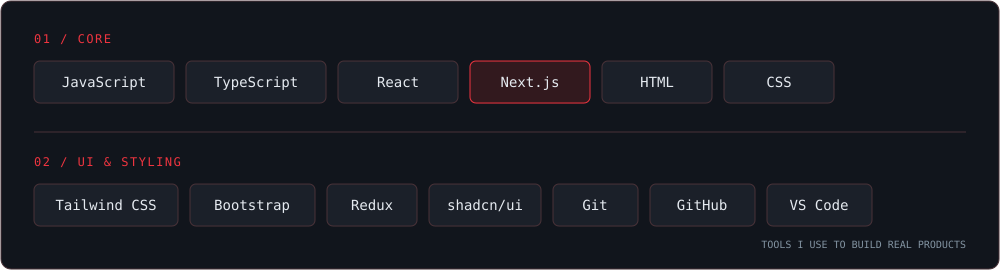

 

 

## `~/about`

  
   
  <i>"Great things are built one line of code at a time."</i>

 

## `~/stack`

  

 

## `~/github-insights`

  <!-- آمارهای گیت‌هاب خودت رو اینجا بگذار -->

 

## `~/connect`

  

---

<h2 align="center">📈 GitHub Insights</h2>

  
  

 

  
  

 

<h3 align="center">🐍 Snake Contribution Grid</h3>

  <picture>
    <source media="(prefers-color-scheme: dark)" srcset="https://raw.githubusercontent.com/saji-sis/saji-sis/output/github-contribution-grid-snake-dark.svg">
    <source media="(prefers-color-scheme: light)" srcset="https://raw.githubusercontent.com/saji-sis/saji-sis/output/github-contribution-grid-snake.svg">
    
  </picture>

---
