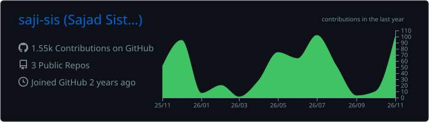
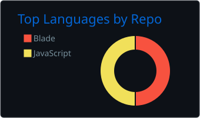
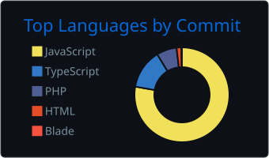
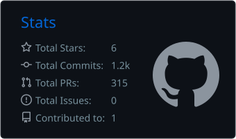
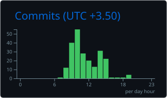

 

 

## `~/about`

  
   
  <i>"Great things are built one line of code at a time."</i>

 

## `~/stack`

  

 

## `~/github-insights`

  
  
    
  
  
  
  
    
  
  
  

 

### 🐍 Contribution Snake

  <picture>
    <source media="(prefers-color-scheme: dark)" srcset="https://raw.githubusercontent.com/saji-sis/saji-sis/output/github-contribution-grid-snake-dark.svg"/>
    <source media="(prefers-color-scheme: light)" srcset="https://raw.githubusercontent.com/saji-sis/saji-sis/output/github-contribution-grid-snake.svg"/>
    
  </picture>

 

## `~/projects`

### 🚛 TowingTask
A multi-company towing and vehicle transportation management system.

**Tech Stack:** React · Next.js · TypeScript · Tailwind

🔗 [View Repository](https://github.com/saji-sis/TowingTask)

---

### 👜 Nafis Leather
An e-commerce platform with modern shopping experience and admin panel (Persian RTL).

**Tech Stack:** Next.js · React · JavaScript · CSS

🔗 [View Repository](https://github.com/saji-sis/Nafis-Leather)

---

### 💱 Fasihi Exchange
Currency exchange management application with role-based access.

**Tech Stack:** Next.js · React · TypeScript · Tailwind

🔗 [View Repository](https://github.com/saji-sis/Fasihi-Exchange)

 

## `~/connect`

  

